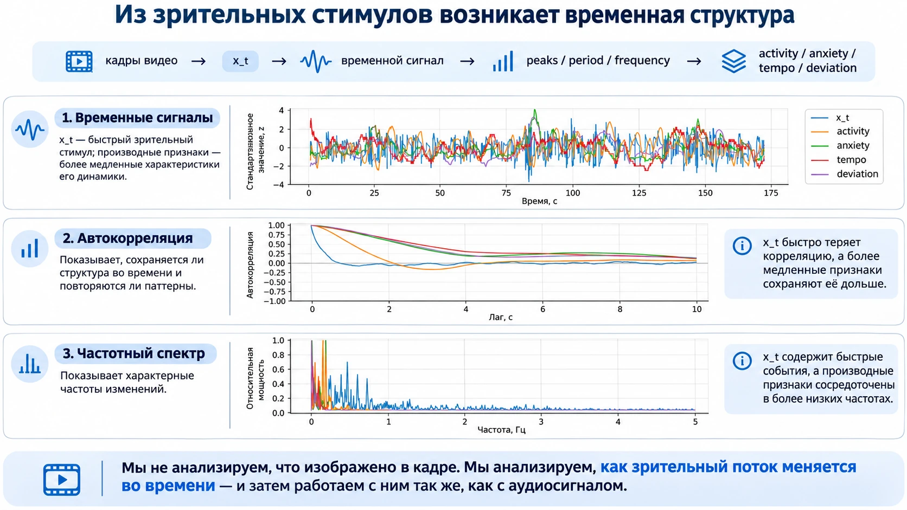
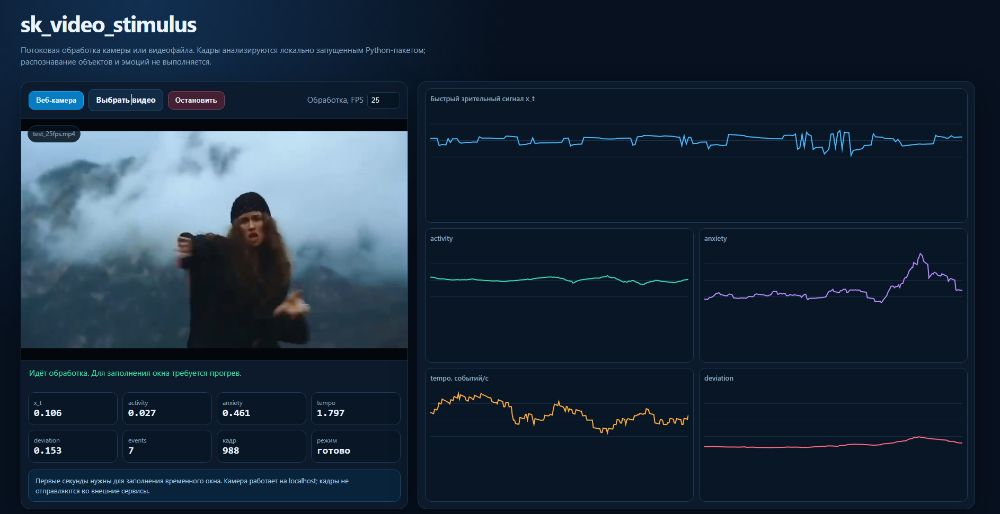
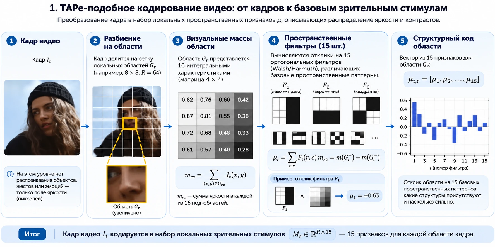
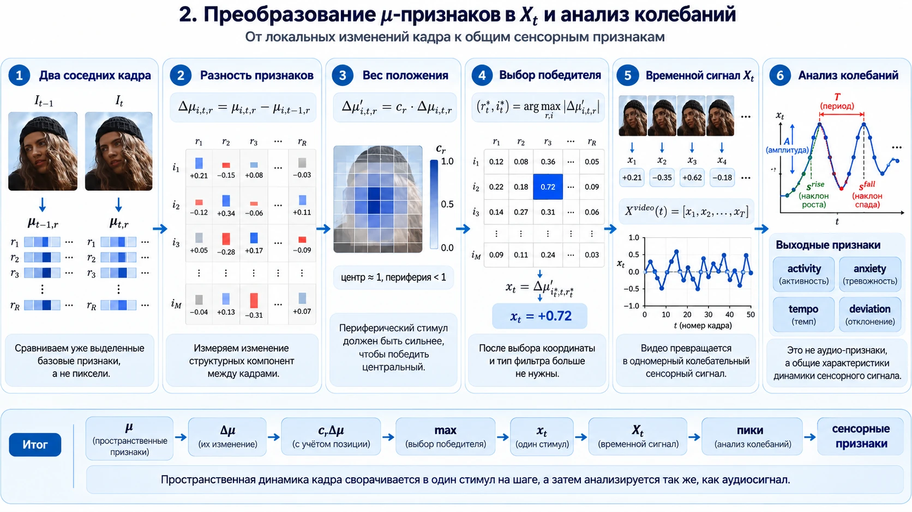
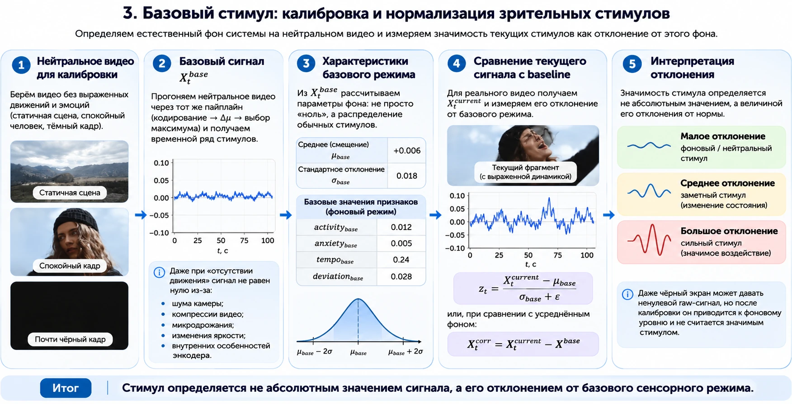
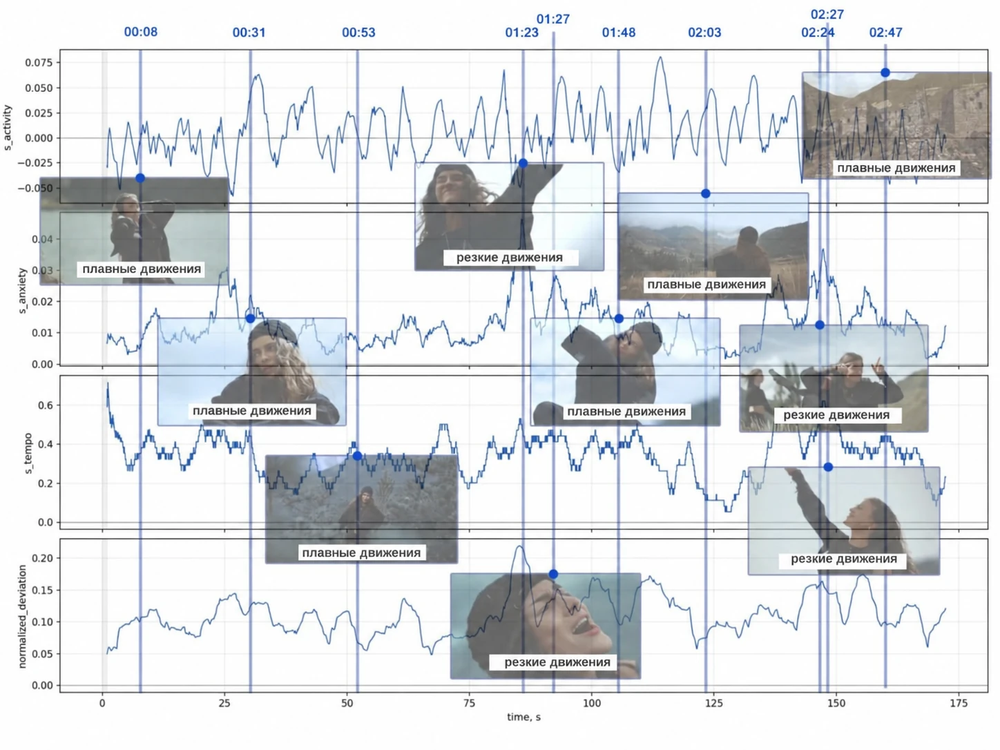

# sk_video_stimulus

[](https://pypi.org/project/sk-video-stimulus/)
[](https://pypi.org/project/sk-video-stimulus/)

**Потоковое преобразование видео в низкоуровневые характеристики динамики зрительного стимула.**

[Статья о методе](https://github.com/iproxy3d/sk_video_stimulus/blob/main/docs/article.md) · [Алгоритм](https://github.com/iproxy3d/sk_video_stimulus/blob/main/docs/algorithm.md) · [Калибровка](https://github.com/iproxy3d/sk_video_stimulus/blob/main/docs/calibration.md) · [Признаки](https://github.com/iproxy3d/sk_video_stimulus/blob/main/docs/features.md) · [Примеры](https://github.com/iproxy3d/sk_video_stimulus/blob/main/docs/examples.md) · [Web dashboard](https://github.com/iproxy3d/sk_video_stimulus/blob/main/docs/dashboard.md) · [Интеграция](https://github.com/iproxy3d/sk_video_stimulus/blob/main/docs/emotional-state-integration.md)



`sk_video_stimulus` отвечает на вопрос **«как меняется зрительный поток во времени?»**. Пакет не распознаёт объекты, жесты или эмоции. Он превращает кадры видео либо поток камеры в одномерный сигнал `x_t`, а затем вычисляет четыре характеристики его динамики:

| Признак | Смысл |
|---|---|
| `activity` | подписанная интенсивность и направление изменения |
| `anxiety` | нерегулярность и резкость динамики; это не распознанная эмоция |
| `tempo` | частота значимых максимумов и минимумов, событий/с |
| `deviation` | мощность отклонения сигнала от спокойного режима |

```text
кадры → пространственные μ-признаки → быстрые/медленные изменения
      → глобальный сигнал x_t → activity / anxiety / tempo / deviation
      → калибровка относительно нейтрального видео
```

## Установка

Пакет опубликован в [PyPI](https://pypi.org/project/sk-video-stimulus/) и поддерживает Python 3.10–3.12.

Рекомендуемая установка со всеми зависимостями для чтения видео и построения графиков:

```bash
python -m pip install "sk-video-stimulus[all]"
```

Минимальная установка для обработки уже загруженных кадров:

```bash
python -m pip install sk-video-stimulus
```

Доступные дополнительные зависимости:

| Вариант | Команда | Назначение |
|---|---|---|
| `video` | `python -m pip install "sk-video-stimulus[video]"` | чтение видеофайлов и веб-камеры через OpenCV |
| `plot` | `python -m pip install "sk-video-stimulus[plot]"` | построение диагностических графиков |
| `demo` | `python -m pip install "sk-video-stimulus[demo]"` | локальный web dashboard |
| `all` | `python -m pip install "sk-video-stimulus[all]"` | видео, графики и dashboard |

Для разработки из исходного кода:

```bash
git clone https://github.com/iproxy3d/sk_video_stimulus.git
cd sk_video_stimulus
python -m pip install -e ".[all]"
```

## Быстрый запуск

В [`examples/videos`](https://github.com/iproxy3d/sk_video_stimulus/tree/main/examples/videos) находятся три коротких видео с частотой 25 кадров/с. Они позволяют воспроизвести весь сценарий четырьмя командами без подготовки собственных данных.

### 1. Извлечь исходные признаки

```bash
sk-video-stimulus examples/videos/input_25fps.mp4 \
  --output results/video_features.csv \
  --image-size 256 \
  --region-grid 4
```

### 2. Построить нейтральный профиль

```bash
sk-video-stimulus examples/videos/neutral_25fps.mp4 \
  --calibrate-profile results/video_neutral_profile.json \
  --output results/neutral_features.csv
```

### 3. Нормализовать тестовое видео

```bash
sk-video-stimulus examples/videos/test_25fps.mp4 \
  --profile results/video_neutral_profile.json \
  --output results/test_features.csv
```

### 4. Построить диагностические графики

```bash
sk-video-stimulus-plot \
  results/video_features.csv \
  results/test_features.csv \
  --output-dir results/plots
```

Исходные имена скриптов также сохранены для совместимости:

```bash
python video_feature_extractor.py examples/videos/input_25fps.mp4 --output results/video_features.csv
python plot_video_features.py results/video_features.csv --output-dir results/plots
```

## Программное использование

```python
from sk_video_stimulus import VideoFeatureExtractor

extractor = VideoFeatureExtractor()

for frame in frames:
    sample = extractor.process_frame(frame)
    if sample.ready:
        print(sample.activity, sample.anxiety, sample.tempo, sample.deviation)
```

Состояние потокового анализатора можно сохранить через `state_dict()` и восстановить через `load_state_dict()`.

## Готовые примеры Python

Пример обработки видеофайла использует OpenCV только для чтения кадров, а каждый кадр передаёт публичному API пакета:

```bash
sk-video-stimulus-video examples/videos/test_25fps.mp4
```

Пример веб-камеры показывает изображение и текущие значения признаков. Для выхода нажмите `Q` или `Esc`:

```bash
sk-video-stimulus-webcam --camera 0
```

Обе команды устанавливаются вместе с вариантом `[video]` или `[all]`. Исходный код простых примеров находится в каталоге [`examples`](https://github.com/iproxy3d/sk_video_stimulus/tree/main/examples), где их также можно запустить как обычные `.py`-файлы. Подробное объяснение приведено в [документации примеров](https://github.com/iproxy3d/sk_video_stimulus/blob/main/docs/examples.md).

## Интерактивный web dashboard

Dashboard — отдельная демонстрация возможностей алгоритма. Он принимает поток браузерной камеры или локальный видеофайл, показывает исходное изображение и в реальном времени строит графики `x_t`, `activity`, `anxiety`, `tempo` и `deviation`.



```bash
python -m pip install "sk-video-stimulus[demo]"
sk-video-stimulus-demo
```

Затем откройте [http://127.0.0.1:8000](http://127.0.0.1:8000). Обработка выполняется локально: браузер отправляет кадры только запущенному на компьютере Python-серверу. Полная инструкция: [docs/dashboard.md](https://github.com/iproxy3d/sk_video_stimulus/blob/main/docs/dashboard.md).

Цифровые карточки показывают последнее рассчитанное значение, а графики — его недавнюю историю. `events` — число значимых максимумов и минимумов в текущем окне анализа, `кадр` — номер обработанного кадра, `режим` сообщает о прогреве или готовности окна. Dashboard показывает сырые признаки текущей записи; для сравнения разных камер и видео используйте [нейтральную калибровку](https://github.com/iproxy3d/sk_video_stimulus/blob/main/docs/calibration.md).

## Что происходит внутри



Кадр переводится в оттенки серого и делится на области. В каждой области вычисляются отклики 15 знаковых пространственных масок. Между соседними кадрами измеряются быстрые и медленные изменения, после чего глобальный максимум по модулю образует `x_t` с сохранением знака.



Подробное математическое описание приведено в [документации алгоритма](https://github.com/iproxy3d/sk_video_stimulus/blob/main/docs/algorithm.md).

## Нейтральная калибровка

Абсолютное значение признака ещё не показывает значимость стимула: шум камеры, сжатие и микродвижения дают ненулевой фон. Поэтому пакет строит фиксированный профиль по нейтральному видео и измеряет отклонение текущего сигнала от него.



Пример готового профиля находится в [`examples/profiles/video_neutral_profile.json`](https://github.com/iproxy3d/sk_video_stimulus/blob/main/examples/profiles/video_neutral_profile.json).

## Результаты и диагностика

Репозиторий содержит реальные CSV и заранее построенные графики:

- [`examples/data`](https://github.com/iproxy3d/sk_video_stimulus/tree/main/examples/data) — сырые, нейтральные и нормализованные временные ряды;
- [`assets/plots`](https://github.com/iproxy3d/sk_video_stimulus/tree/main/assets/plots) — временные графики, автокорреляция и спектр;
- [демонстрационные результаты](https://github.com/iproxy3d/sk_video_stimulus/blob/main/docs/examples.md) — объяснение результатов и ограничений.



## Место в системе эмоционального состояния

`sk_video_stimulus` извлекает сенсорную динамику. Семантическое описание происходящего — кто действует, что делает и с каким объектом — выполняет отдельная модель [Florence-2 SVOA](https://github.com/iproxy3d/florence2-svoa).

Опциональный `VideoProtoEmotionMapper` переводит нормализованные признаки в потенциалы протoэмоций для интеграции с [emotional-state-agents](https://github.com/iproxy3d/emotional-state-agents). Он не является классификатором эмоций и не создаёт состояние с нуля.

## Структура репозитория

```text
src/sk_video_stimulus/
├── extractor.py        # кадры → x_t → четыре признака → калибровка
├── plotting.py         # временные ряды, ACF и частотный спектр
├── dashboard.py        # локальный HTTP API и запуск web dashboard
└── templates/          # браузерный интерфейс dashboard
tests/                  # алгоритмические и интеграционные тесты
examples/*.py           # простые примеры видеофайла и веб-камеры
examples/data/          # готовые CSV
examples/profiles/      # нейтральный профиль
examples/videos/        # три демонстрационных MP4 с частотой 25 кадров/с
assets/images/          # объясняющие инфографики
assets/plots/           # рассчитанные результаты
docs/                   # подробное описание метода
```

## Тесты

```bash
python -m unittest discover -s tests -v
```

## Статус и ограничения

Это исследовательская реализация. Текущие пороги и масштабы проверены на приложенных примерах, но ещё не являются универсально валидированными для разных камер, частот кадров и типов сцен. Сравнивать разные записи следует только при совместимых настройках и нейтральном профиле.

## Лицензия

Код распространяется по лицензии [MIT](https://github.com/iproxy3d/sk_video_stimulus/blob/main/LICENSE). Пользователь отвечает за право распространения добавляемых видео.
