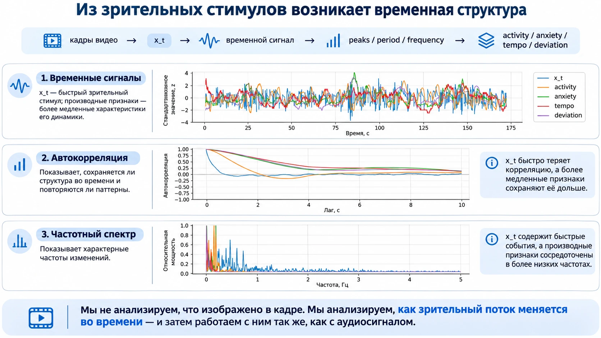

# sk_video_stimulus

**Streaming extraction of low-level visual stimulus dynamics from video.**

`sk_video_stimulus` converts frames or a camera stream into a scalar signal `x_t`, then derives four temporal features: signed activity, dynamic irregularity, event tempo and deviation from a neutral regime.

The package does **not** recognize objects, gestures or emotions. Its output describes how the visual stream changes over time. Semantic event extraction is handled separately by [Florence-2 SVOA](https://github.com/iproxy3d/florence2-svoa).



## Install

```bash
git clone https://github.com/iproxy3d/sk_video_stimulus.git
cd sk_video_stimulus
python -m pip install -e ".[all]"
```

## Quick start

```bash
sk-video-stimulus examples/videos/input_25fps.mp4 \
  --output results/video_features.csv

sk-video-stimulus examples/videos/neutral_25fps.mp4 \
  --calibrate-profile results/video_neutral_profile.json \
  --output results/neutral_features.csv

sk-video-stimulus examples/videos/test_25fps.mp4 \
  --profile results/video_neutral_profile.json \
  --output results/test_features.csv

sk-video-stimulus-plot results/test_features.csv --output-dir results/plots
```

See the [Russian README](README.md) and the files in [`docs`](docs) for the full algorithm, calibration procedure, example outputs and limitations.

## License

MIT. Source videos may have their own licenses and distribution restrictions.
