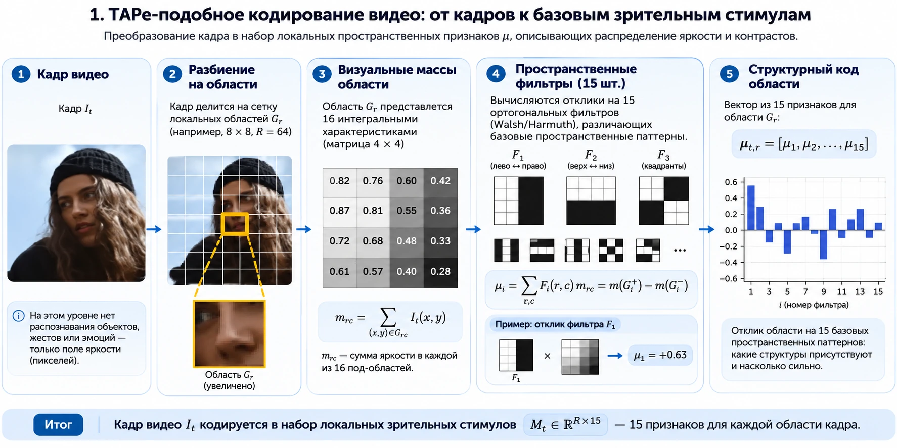
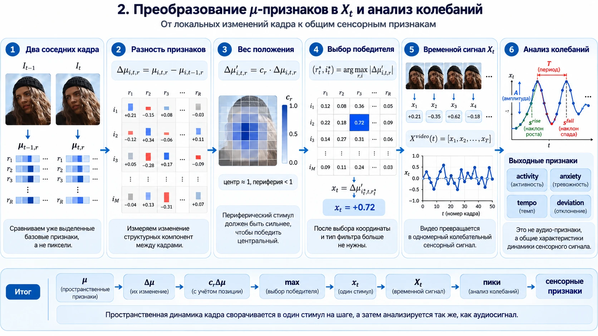

# Алгоритм извлечения видеостимула

## 1. Пространственное кодирование

Каждый кадр переводится в оттенки серого, масштабируется до фиксированного размера и делится на `region_rows × region_cols` областей. Внутри каждой области яркость агрегируется в матрицу `4 × 4`.

Из DC-компоненты и 15 знаковых пространственных масок используется только 15 недегенеративных компонентов:

```text
μ[t, region, component]
```

Они описывают не объект, а распределение яркости и контраста внутри области.



## 2. Быстрые и медленные изменения

Для текущего кадра вычисляются два канала:

```text
fast = μ[t] - μ[t-1]
slow = μ[t] - baseline_μ[t]
```

`baseline_μ` обновляется экспоненциально со временем `baseline_tau_seconds`. Периферические области получают настраиваемый вес. Из всех областей, компонентов и двух временных каналов выбирается значение с максимальным модулем. Его знак сохраняется:

```text
x_t = signed_argmax_abs(weight × {fast, slow})
```

При стандартной нормализации `x_t` ограничен диапазоном `[-1, 1]`.



## 3. Оконный анализ

В скользящем окне `window_seconds` вычисляются:

- среднее и наклон контура;
- локальные положительные и отрицательные экстремумы;
- частота пересечений нуля;
- чередование знаков событий;
- вариативность интервалов между событиями;
- RMS-мощность сигнала.

До накопления `warmup_seconds` результат имеет `ready=false` и нулевые оконные признаки. Это не пропущенные данные, а явный период прогрева.

## 4. Потоковое состояние

`FrameSignalExtractor`, `OscillationFeatureExtractor` и `VideoFeatureExtractor` поддерживают `state_dict()` и `load_state_dict()`. Это позволяет продолжить обработку потока без потери медленного фона и скользящего окна.

## Что алгоритм не делает

- не использует оптический поток;
- не обнаруживает лица, позы и объекты;
- не классифицирует действия;
- не определяет эмоциональное состояние;
- не сравнивает семантику соседних кадров.

Он измеряет только пространственно-временную динамику яркости.
