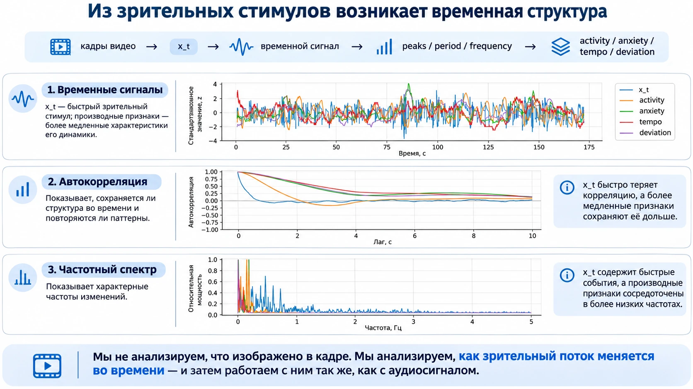
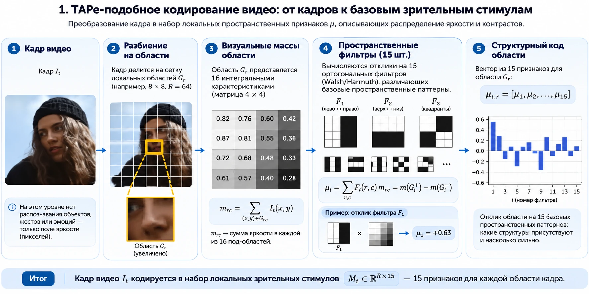
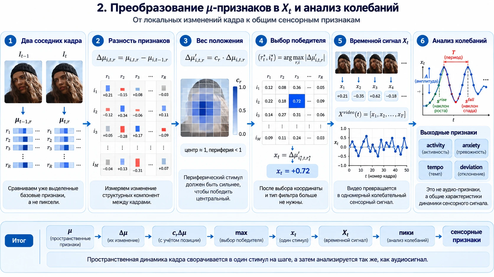
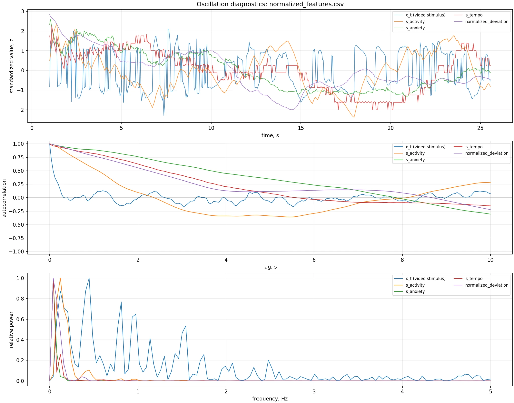
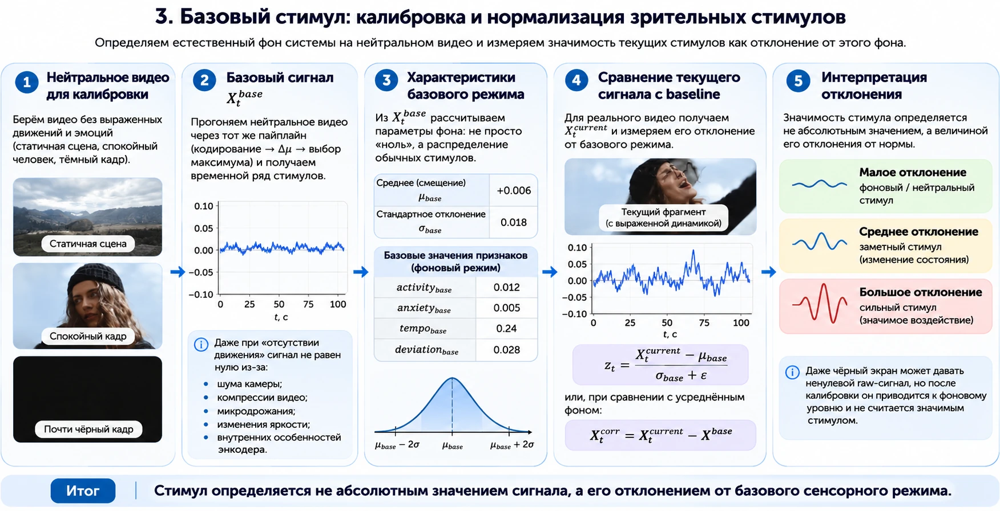
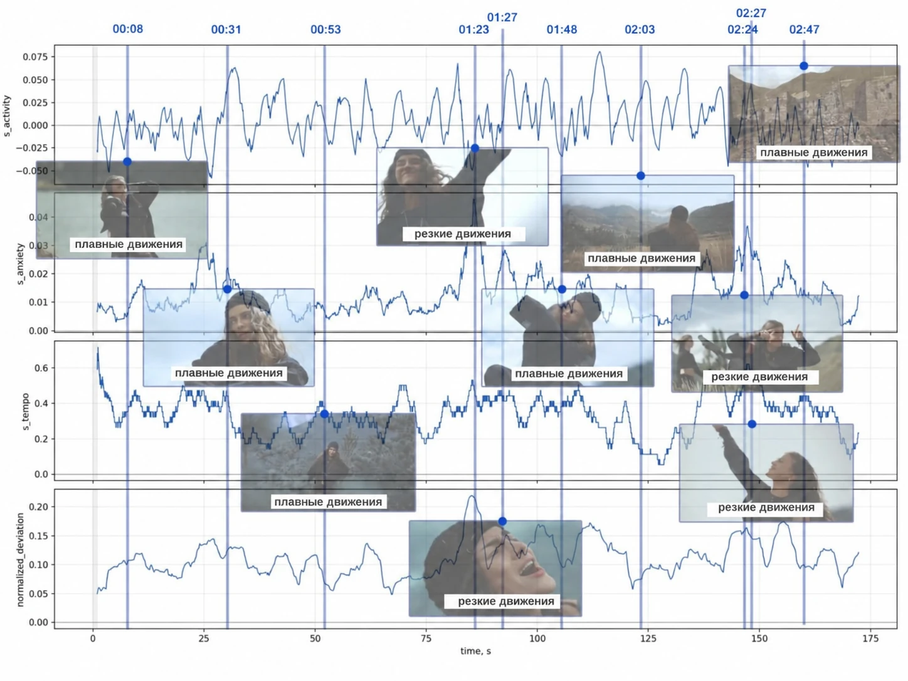
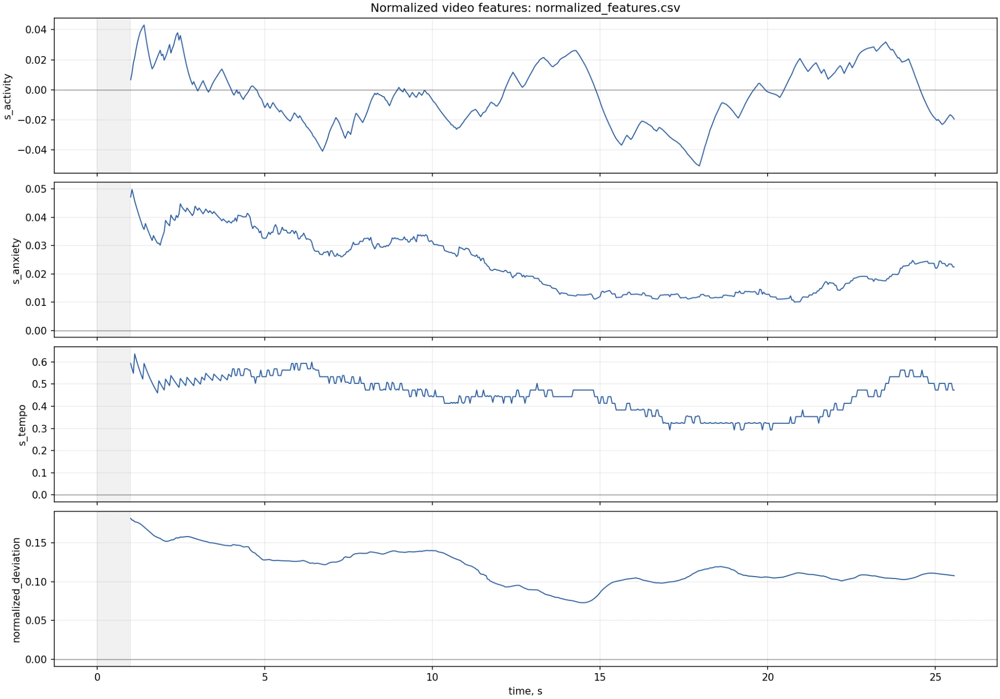
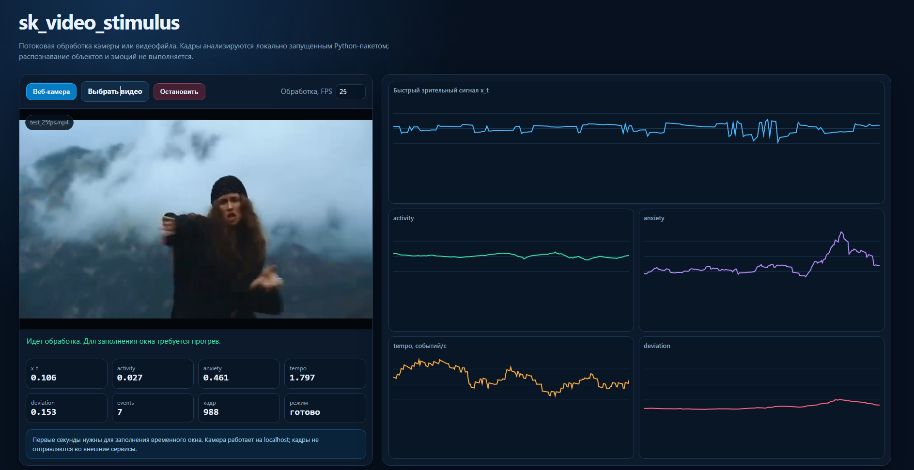
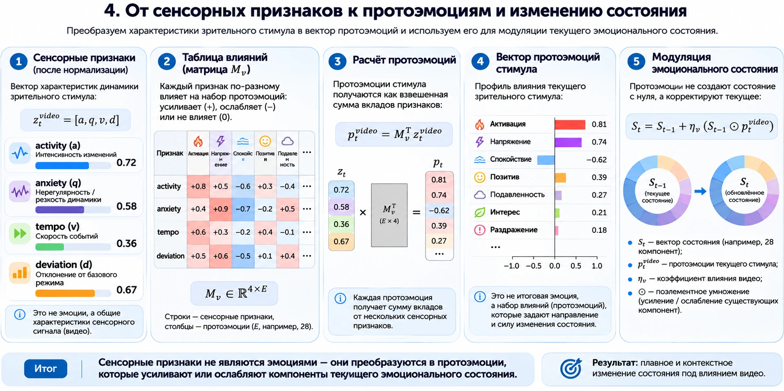
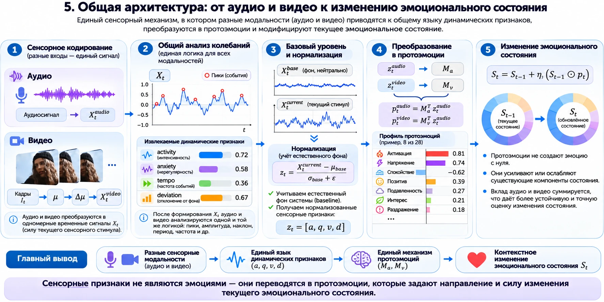

# От видеокадров к динамике зрительного стимула

## Как `sk_video_stimulus` превращает видео в измеримый временной сигнал

Обычная модель компьютерного зрения отвечает на вопросы «что изображено?» и «что происходит?». `sk_video_stimulus` решает другую задачу: измеряет, **как зрительный поток меняется во времени**.

Пакет не распознаёт людей, предметы, жесты или эмоции. Он последовательно преобразует кадры видео или веб-камеры в одномерный сигнал `x_t`, а затем извлекает из его динамики четыре характеристики:

- `activity` — подписанный уровень и направление изменений;
- `anxiety` — нерегулярность и резкость динамики;
- `tempo` — частота значимых максимумов и минимумов;
- `deviation` — общая мощность отклонения.

```text
кадры
  → пространственные μ-компоненты
  → быстрые и медленные изменения
  → один подписанный отсчёт x_t на кадр
  → скользящее временное окно
  → activity / anxiety / tempo / deviation
  → нейтральная калибровка
```



Этот подход полезен там, где смысл кадра и сила сенсорного воздействия должны рассматриваться раздельно. Неподвижный испуганный человек может быть семантически важен, но создавать слабую пиксельную динамику. Резкое движение камеры, вспышка света или быстрый монтаж, наоборот, создают сильный низкоуровневый стимул, хотя сами по себе ничего не говорят об эмоции человека.

## 1. Два разных вопроса к одному видео

У видеопотока есть как минимум два уровня описания.

| Уровень | Вопрос | Подходящий инструмент |
|---|---|---|
| Семантический | Кто действует, что делает и с чем? | модель компьютерного зрения, например Florence-2 SVOA |
| Сенсорный | Насколько сильно, быстро и нерегулярно меняется изображение? | `sk_video_stimulus` |

Эти уровни нельзя подменять друг другом. Сильный сенсорный всплеск не доказывает страх, гнев или радость. А правильно распознанный жест ещё не показывает, был ли он плавным, резким, повторяющимся или почти неподвижным.

`sk_video_stimulus` сознательно ограничивает свою ответственность вторым вопросом. Благодаря этому пакет можно применять к людям, животным, природным сценам, экранным интерфейсам и любым другим видеопотокам без обучения детектора объектов.

## 2. Пространственное кодирование кадра

Каждый входной кадр приводится к фиксированному размеру, переводится в оттенки серого и нормируется в диапазон `[0, 1]`. По умолчанию используется изображение `256 × 256` пикселей.

Кадр делится на постоянную сетку областей. Стандартная конфигурация использует `4 × 4` области. Геометрия не отслеживает объекты и не перемещается между кадрами: одна и та же координата всегда относится к одной и той же части поля зрения.

Каждая область дополнительно делится на внутреннюю сетку `4 × 4`. Для каждой ячейки вычисляется визуальная масса — сумма яркости её пикселей:

$$
m_{t,r,a,b}=\sum_{(x,y)\in G_{r,a,b}} I_t(x,y),
\qquad a,b\in\{0,1,2,3\}.
$$

Здесь:

- $t$ — номер кадра;
- $r$ — номер области кадра;
- $G_{r,a,b}$ — ячейка внутренней сетки;
- $I_t(x,y)$ — нормированная яркость пикселя.

Результат для одной области — матрица визуальных масс $4 × 4$.



### Пятнадцать структурных компонентов

Для описания распределения яркости используются четыре базовых одномерных знаковых паттерна:

$$
w_0=[+1,+1,+1,+1],
$$

$$
w_1=[+1,+1,-1,-1],
$$

$$
w_2=[+1,-1,-1,+1],
$$

$$
w_3=[+1,-1,+1,-1].
$$

Из их внешних произведений строятся 16 масок $4 × 4$. Первая маска содержит только общую яркость области и исключается. Остальные 15 описывают пространственные противопоставления: верх и низ, левую и правую части, крупные квадранты и более частые чередования.

Для каждой области рассчитывается:

$$
\mu_{i,t,r}
=
\sum_{a=0}^{3}\sum_{b=0}^{3}
F_i(a,b)m_{t,r,a,b},
\qquad i=1,\ldots,15.
$$

Таким образом, один кадр превращается в тензор:

$$
\boldsymbol{\mu}_t=[\mu_{i,t,r}]\in\mathbb{R}^{R\times15},
$$

где $R$ — число областей.

Компоненты не являются признаками объекта. Они описывают только структуру яркости и контраста внутри фиксированных участков кадра.

## 3. Быстрые и медленные изменения

Один кадр сам по себе ещё не образует видеостимул. Поэтому текущий тензор $\boldsymbol{\mu}_t$ сравнивается с двумя точками отсчёта.

### Быстрый канал

Быстрый канал сравнивает соседние кадры:

$$
\Delta\boldsymbol{\mu}_t^{fast}=\boldsymbol{\mu}_t-\boldsymbol{\mu}_{t-1}.
$$

Он реагирует на изменения, произошедшие прямо сейчас: резкое движение, появление объекта, монтажную склейку или вспышку.

### Медленный канал

Медленный канал сравнивает текущий кадр с адаптивным фоном:

$$
\Delta\boldsymbol{\mu}_t^{slow}=\boldsymbol{\mu}_t-B_{t-1}.
$$

$B_{t-1}$ — экспоненциально обновляемая базовая линия. Коэффициент обновления зависит от фактического интервала между кадрами:

$$
\alpha_t=1-\exp\left(-\frac{\Delta t}{\tau}\right),
$$

$$
B_t=(1-\alpha_t)B_{t-1}+\alpha_t\boldsymbol{\mu}_t.
$$

Параметр $\tau$ задаётся через `baseline_tau_seconds`. По умолчанию он равен одной секунде.

Медленный канал отвечает на вопрос: насколько текущая структура отличается от того, что недавно стало нормой? Поэтому новое устойчивое положение может ещё некоторое время давать медленный отклик, хотя изменение между соседними кадрами уже исчезло.

Порядок вычислений принципиален: сначала рассчитываются `fast` и `slow` относительно предыдущих состояний, затем выбирается значение текущего кадра и только после этого обновляется baseline.

## 4. Пространственный приоритет и глобальный победитель

Для каждой области заранее вычисляется постоянный вес $c_r$. Центральные области получают вес ближе к `1`, периферийные — к значению `peripheral_weight`, которое по умолчанию равно `0.65`.

$$
X_{t,r,i}^{fast}=c_r\Delta\mu_{i,t,r}^{fast},
$$

$$
X_{t,r,i}^{slow}=c_r\Delta\mu_{i,t,r}^{slow}.
$$

Вес влияет только на конкуренцию областей. Сильное периферийное изменение всё равно может победить слабое центральное.

После этого быстрые и медленные отклики всех областей и всех 15 компонентов участвуют в одном поиске максимума:

$$
(q_t^*,r_t^*,i_t^*)
=
\underset{q\in\{fast,slow\},r,i}{\arg\max}
\left|X_{t,r,i}^{q}\right|.
$$

В результирующий поток записывается само значение победителя:

$$
x_t=X_{t,r_t^*,i_t^*}^{q_t^*}.
$$

Максимум ищется по модулю, но знак сохраняется. Поэтому `−0.8` побеждает `+0.3`, а в последовательность попадает именно `−0.8`.

Для стандартного режима значение делится на фиксированную теоретическую площадь области и ограничивается диапазоном `[-1, 1]`. Это геометрическая нормализация, одинаковая для всех видео, а не подстройка по текущей записи.



Первый кадр инициализирует предыдущее состояние и baseline, поэтому возвращает `x_0 = 0`. После этого каждый новый кадр создаёт ровно один отсчёт:

$$
X^{video}=[x_0,x_1,\ldots,x_{T-1}].
$$

При обработке 25 кадров в секунду одна секунда видео создаёт 25 значений `x_t`.

## 5. Из видеопотока получается временной сигнал

После формирования `x_t` пространственная координата, номер маски и тип победившего канала больше не используются оконным анализатором. Он получает поток пар `(timestamp, x_t)` и работает с ним как с обычным колебательным сигналом.

Значения хранятся в кольцевом буфере. По умолчанию анализируется окно последних четырёх секунд. Первую секунду занимает прогрев: пока история недостаточна, `ready=false`, а оконные признаки равны нулю.

Внутри окна ищутся положительные и отрицательные локальные экстремумы. Событие должно:

- иметь модуль не меньше `peak_threshold`, по умолчанию `0.04`;
- быть локальным максимумом или минимумом;
- находиться от предыдущего выбранного события не ближе `min_peak_distance_seconds`, по умолчанию `0.12` секунды.

Если два кандидата расположены слишком близко, сохраняется более сильный по модулю.

## 6. Четыре характеристики динамики

### `deviation`: сила отклонения

`deviation` — среднеквадратическая мощность сигнала в текущем окне:

$$
deviation
=
\sqrt{\frac{1}{N}\sum_{k=1}^{N}x_k^2}.
$$

Для нормированного `x_t` результат ограничивается диапазоном `[0, 1]`. Признак не имеет знака и показывает общую силу изменений.

### `activity`: подписанный уровень и тренд

Для окна вычисляются среднее значение и линейный наклон контура. В реализации пакета:

$$
activity
=
clip\left(
\overline{x}+0.25\,slope\,D,
-1,1
\right),
$$

где $D$ — длительность накопленного окна. Умножение наклона на длительность делает его вклад независимым от единиц временной шкалы.

Знак `activity` не означает положительную или отрицательную эмоцию. Это знак доминирующего направления пространственных откликов.

### `tempo`: плотность событий

$$
tempo=\frac{N_{events}}{D}.
$$

Считаются и положительные максимумы, и отрицательные минимумы. Поэтому синусоидальное движение частотой 2 Гц обычно даёт около четырёх экстремумов в секунду.

### `anxiety`: нерегулярность динамики

Название `anxiety` исторически связано с моделью эмоционального состояния, но в самостоятельном пакете это **не оценка тревоги человека**. Признак объединяет:

- мощность сигнала;
- частоту пересечений нуля;
- темп событий;
- чередование знаков экстремумов;
- нерегулярность интервалов между событиями.

Текущая формула:

$$
anxiety
=
deviation\left(
ZCR
+tempo\cdot alternation
+\min(CV_{interval},3)
\right).
$$

`anxiety` остаётся сырым неотрицательным значением без универсальной верхней границы. Для сравнения разных записей его необходимо калибровать.



## 7. Почему необходим нейтральный профиль

Даже почти неподвижное видео не создаёт идеальный ноль. На результат влияют:

- шум матрицы камеры;
- JPEG- и видеокомпрессия;
- изменения освещения;
- автоматическая экспозиция;
- микродрожание камеры;
- небольшие движения фона.

Поэтому значимость стимула определяется не абсолютным сырым числом, а отклонением от нейтрального режима той же системы.



Нейтральное видео проходит через тот же pipeline и с теми же настройками. По всем готовым окнам сохраняются средние значения:

$$
\mu_{base}
=
[activity_{base},anxiety_{base},tempo_{base},deviation_{base}].
$$

Текущий пакет использует фиксированные масштабы анализатора:

$$
s_{activity}
=
clip\left(\frac{activity-activity_{base}}{2},-1,1\right),
$$

$$
s_{anxiety}
=
clip\left(\frac{anxiety-anxiety_{base}}{scale_{anxiety}},-1,1\right),
$$

$$
s_{tempo}
=
clip\left(\frac{tempo-tempo_{base}}{scale_{tempo}},-1,1\right),
$$

$$
normalized\_deviation
=
clip\left(
|deviation-deviation_{base}|,
0,1
\right).
$$

Для `tempo` масштаб определяется частотой кадров и минимальной дистанцией между событиями. Масштаб `anxiety` складывается из предельных вкладов частоты пересечений, темпа и интервальной нерегулярности. Границы не расширяются по текущему ролику, поэтому необычный стимул не поглощается собственной нормализацией.

Профиль хранит конфигурацию экстрактора. Пакет отклонит его, если изменились FPS, размер изображения, сетка областей, временная константа baseline, окно, прогрев или пороги событий.

## 8. Что видно на реальном видео

На графиках ниже признаки сопоставлены с конкретными моментами демонстрационного ролика.



Из этого примера видны несколько важных свойств:

- `x_t` реагирует быстрее остальных признаков, потому что вычисляется для каждого кадра;
- оконные характеристики меняются плавнее и некоторое время сохраняют влияние события;
- регулярное движение отражается в `tempo`;
- резкие и нерегулярные участки повышают `anxiety`;
- общая сила отклонений отражается в `deviation`;
- статичная, но эмоционально выразительная поза может создавать небольшой низкоуровневый сигнал.



Графики нельзя интерпретировать как готовые эмоциональные метки. Они показывают физическую динамику зрительного потока и её отклонение от выбранного нейтрального режима.

## 9. Потоковая работа через Python

Минимальная установка:

```bash
python -m pip install sk-video-stimulus
```

Обработка уже полученных кадров:

```python
from sk_video_stimulus import VideoFeatureExtractor

extractor = VideoFeatureExtractor()

for frame in frames:
    sample = extractor.process_frame(frame)

    if sample.ready:
        print(
            sample.x_t,
            sample.activity,
            sample.anxiety,
            sample.tempo,
            sample.deviation,
        )
```

`VideoFeatureExtractor` хранит предыдущий кадр, адаптивный фон и скользящее окно. Через `state_dict()` и `load_state_dict()` это состояние можно сохранять и восстанавливать без потери временной истории.

### Готовый сценарий с видеофайлом

```bash
python -m pip install "sk-video-stimulus[video]"
sk-video-stimulus-video examples/videos/test_25fps.mp4
```

### Веб-камера

```bash
sk-video-stimulus-webcam --camera 0
```

### Создание и применение нейтрального профиля

```bash
sk-video-stimulus examples/videos/neutral_25fps.mp4 \
  --calibrate-profile results/video_neutral_profile.json \
  --output results/neutral_features.csv

sk-video-stimulus examples/videos/test_25fps.mp4 \
  --profile results/video_neutral_profile.json \
  --output results/test_features.csv
```

## 10. Наглядная демонстрация в браузере

Локальный dashboard позволяет выбрать видеофайл или поток веб-камеры и наблюдать `x_t` и четыре оконных признака в реальном времени.



Запуск:

```bash
python -m pip install "sk-video-stimulus[demo]"
sk-video-stimulus-demo
```

После запуска нужно открыть `http://127.0.0.1:8000`.

Обработка выполняется локально. Браузер отправляет кадры только Python-серверу, запущенному на том же компьютере. Dashboard показывает сырые признаки; для воспроизводимого сравнения разных потоков следует использовать CLI или Python API с нейтральным профилем.

## 11. Опциональное преобразование в протоэмоциональный вклад

Самостоятельный результат пакета заканчивается на нормализованных сенсорных признаках:

$$
s_t^{video}
=
[s_{activity},s_{anxiety},s_{tempo}]
$$

и неотрицательном `normalized_deviation`.

Для экспериментов с рекуррентным эмоциональным состоянием пакет содержит `VideoProtoEmotionMapper`. Он применяет таблицу влияний к трём подписанным признакам:

$$
p_t^{video}
=
(s_t^{video})^T M_{signed}
+|s_t^{video}|^T M_{magnitude}.
$$

Вторая матрица реализует элементы `±`, для которых важно отклонение, но не его направление.

Контекстная поправка рассчитывается так:

$$
A_t^{video}
=
\eta_{video}\cdot normalized\_deviation_t
\cdot
\left(previous\_state_{t-1}\odot p_t^{video}\right).
$$



Эта формула имеет важное следствие: при нулевом предыдущем состоянии сенсорный канал не создаёт эмоцию из ничего. Он усиливает или ослабляет уже активные компоненты контекста.

Одинаковое движение может сопровождать страх, радость, гнев, игру или техническое перемещение камеры. Поэтому `VideoProtoEmotionMapper` является экспериментальным интеграционным адаптером, а не классификатором эмоций.

## 12. Место пакета в общей архитектуре



В полной системе компоненты разделены по ответственности:

- `sk_video_stimulus` измеряет динамику зрительного потока;
- [Florence-2 SVOA](https://github.com/iproxy3d/florence2-svoa) извлекает структурированную семантику события;
- [sk_speech](https://github.com/iproxy3d/sk_speech) анализирует аудиодинамику и преобразует выразительность речи;
- [emotional-state-agents](https://github.com/iproxy3d/emotional-state-agents) объединяет смысл, сенсорные стимулы, память и предыдущее состояние.


Сенсорный признак не является эмоцией. Он задаёт направление и силу возможного изменения, а итог определяется контекстом системы.

## 13. Контрольные проверки алгоритма

| Вход | Ожидаемое поведение |
|---|---|
| Первый кадр | Инициализация `previous_mu` и `baseline_mu`, результат `x_t = 0` |
| Неподвижная однородная сцена | После инициализации `x_t` близок к нулю |
| Однокадровый импульс | Крупный отклик быстрого канала и одиночное событие |
| Устойчивое новое положение | Быстрый отклик уменьшается, медленный сохраняется до адаптации baseline |
| Возврат к исходной сцене | Появляется отклик противоположного направления |
| Равные центр и периферия | Побеждает центр; более сильная периферия всё равно может победить |
| Регулярное движение | Стабильный `tempo` |
| Нерегулярное чередование | Рост `anxiety` |
| Плавное усиление изменений | Рост `deviation`, изменение `activity` согласно тренду |
| Один поток при разных `previous_state` | Сенсорные признаки совпадают, интеграционная поправка различается |

## 14. Ограничения

Текущая реализация является исследовательской.

- Признаки зависят от FPS, разрешения, компрессии, освещения и положения камеры.
- Значения разных устройств нельзя надёжно сравнивать без совместимого нейтрального профиля.
- Дрожание камеры и автоматическая экспозиция являются частью входного сигнала и могут усиливать отклик.
- Алгоритм не отделяет движение человека от движения фона или камеры.
- Название `anxiety` не означает диагностированную тревогу.
- Матрица протоэмоций не является валидированным классификатором эмоционального состояния.
- Текущие пороги проверены на приложенных примерах, но ещё не валидированы на широком наборе камер и сцен.

## 15. Происхождение метода

Идея представления областей изображения через матрицы визуальных масс и многокомпонентные пространственные отклики связана с ранним подходом, описанным в патенте [RU2322694C2 «Способ обработки изображений»](https://patents.google.com/patent/RU2322694C2/ru).

`sk_video_stimulus` не реализует весь описанный там иерархический алгоритм. Пакет использует компактное пространственное ядро `4 × 4`, а потоковая архитектура — быстрый и медленный каналы, глобальная конкуренция, формирование `x_t`, оконный анализ, нейтральная калибровка и Python API — относится к данной реализации.

Статья подготовлена как самостоятельное описание низкоуровневого видеоканала на основе разделов 17–19 проекта [«Эмоциональное состояние агента»](https://iproxy3d.github.io/emotional-state-agents/) и приведена в соответствие с реализацией `sk_video_stimulus` версии `0.3.0`.

