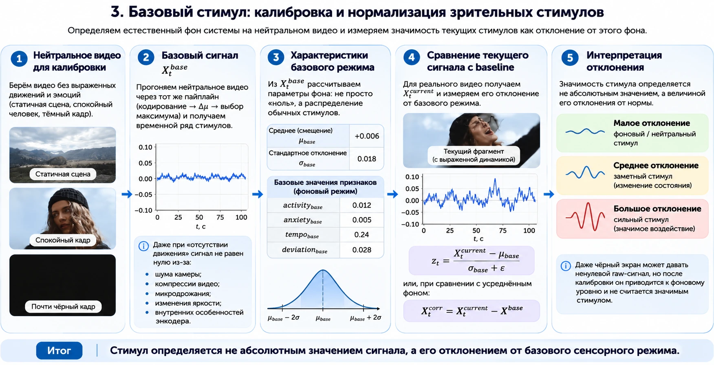

# Нейтральная калибровка

## Зачем нужен профиль

Даже спокойное видео создаёт ненулевой сигнал из-за шума камеры, сжатия, изменений освещения и микродвижений. Поэтому нулевой уровень нельзя надёжно определять по абсолютно чёрному кадру или по одному теоретическому значению.

Профиль строится на нейтральном видео тем же алгоритмом и с теми же настройками, которые будут использоваться при последующей обработке.



## Создание профиля

```bash
sk-video-stimulus examples/videos/neutral_25fps.mp4 \
  --calibrate-profile results/video_neutral_profile.json \
  --output results/neutral_features.csv
```

В JSON сохраняются:

- средние значения четырёх готовых признаков;
- количество использованных окон;
- источник;
- время создания;
- пространственная и временная конфигурации.

## Совместимость

При загрузке профиля пакет проверяет конфигурации. Профиль нельзя молча использовать при другом FPS, размере изображения, сетке регионов, времени медленного фона, размере окна или порогах событий.

## Применение

```bash
sk-video-stimulus examples/videos/test_25fps.mp4 \
  --profile results/video_neutral_profile.json \
  --output results/test_features.csv
```

Профиль должен соответствовать камере и режиму обработки, а не конкретной эмоциональной сцене. Если существенно изменились камера, компрессия, FPS или освещение, калибровку следует повторить.
