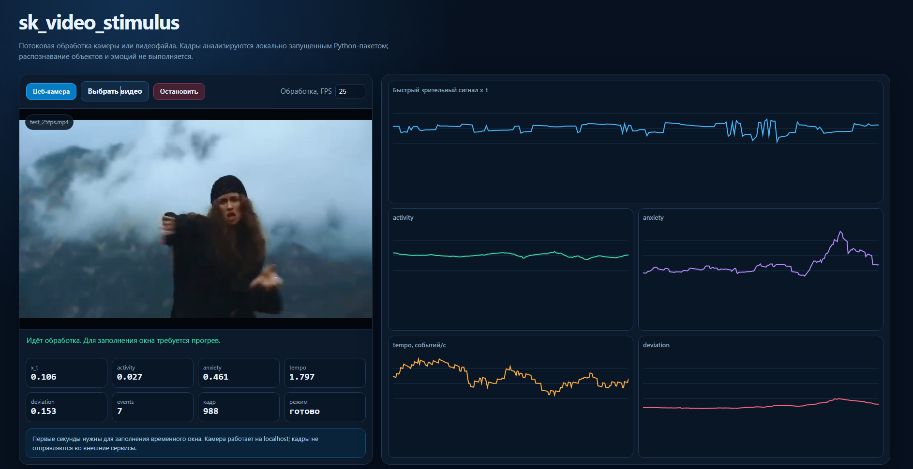

# Web dashboard реального времени

Dashboard показывает работу `sk_video_stimulus` без написания пользовательского интерфейса. Это локальное демонстрационное приложение, использующее тот же публичный `VideoFeatureExtractor`, что и обычный Python-код.



На снимке обрабатывается файл `test_25fps.mp4` с частотой 25 кадров/с. Слева видны видео и последние рассчитанные значения, справа — недавняя история быстрого сигнала и четырёх признаков его динамики.

## Установка и запуск

Для опубликованной версии `0.2.0` и новее:

```bash
python -m pip install "sk-video-stimulus[demo]"
sk-video-stimulus-demo
```

Откройте в браузере:

```text
http://127.0.0.1:8000
```

Для запуска из клонированного репозитория:

```bash
python -m pip install -e ".[demo]"
sk-video-stimulus-demo
```

Порт и адрес можно изменить:

```bash
sk-video-stimulus-demo --host 127.0.0.1 --port 8080
```

## Начало работы

1. Нажмите **Веб-камера** и разрешите браузеру доступ к камере либо нажмите **Выбрать видео** и укажите локальный файл.
2. При необходимости задайте частоту в поле **Обработка, FPS** до выбора источника.
3. Дождитесь, пока значение **режим** изменится с `прогрев` на `готово`.
4. Наблюдайте текущие числа слева и их недавнюю историю справа.
5. Нажмите **Остановить**, чтобы завершить обработку. При повторном запуске или смене источника создаётся новая сессия, а история очищается.

Первые секунды нужны для заполнения временного окна. Во время прогрева `activity`, `anxiety`, `tempo` и `deviation` равны нулю — это штатное поведение, а не ошибка.

## Источники и элементы управления

| Элемент | Что делает |
|---|---|
| **Веб-камера** | запрашивает доступ к камере в браузере и запускает потоковую обработку |
| **Выбрать видео** | открывает локальный видеофайл, воспроизводит и анализирует его в реальном времени |
| **Остановить** | останавливает текущий источник и отправку кадров |
| **Обработка, FPS** | задаёт, сколько кадров в секунду браузер пытается передать анализатору |

**Обработка, FPS** — это частота анализа, а не преобразование исходного видео. При 12 FPS анализируется примерно 12 кадров в секунду, даже если файл записан при 25 или 30 FPS. Реальная скорость также зависит от процессора, разрешения и браузера. Для воспроизводимого сравнения записей используйте одинаковую частоту обработки.

## Что означают числовые карточки

Значения `activity`, `anxiety`, `tempo`, `deviation` и `events` вычисляются не по одному кадру, а по текущему скользящему окну сигнала `x_t`. По умолчанию окно хранит последние 4 секунды, а режим готовности включается после накопления 1 секунды.

| Подпись | Что показывает | Диапазон и единицы |
|---|---|---|
| `x_t` | мгновенное наиболее сильное пространственное изменение между текущим и предыдущими состояниями кодировщика | от `-1` до `1`, безразмерное |
| `activity` | среднее направление сигнала с небольшой поправкой на наклон его контура в текущем окне | от `-1` до `1`, безразмерное |
| `anxiety` | сырую нерегулярность динамики: совместное влияние мощности, смен знака, чередования экстремумов и нерегулярности интервалов | неотрицательное значение без фиксированного верхнего предела |
| `tempo` | частоту значимых положительных и отрицательных экстремумов | событий в секунду |
| `deviation` | среднеквадратическую мощность `x_t` в текущем окне | от `0` до `1` для нормализованного `x_t` |
| `events` | число значимых экстремумов в текущем окне | целое число; это не накопленный итог с начала видео |
| `кадр` | порядковый номер кадра, обработанного текущей сессией | целое число, отсчёт начинается с `0` |
| `режим` | готовность временного окна | `прогрев` или `готово` |

### Как понимать знак `x_t` и `activity`

Знак сохраняет направление отклика выбранной пространственной маски. Он не означает «положительное/отрицательное событие», эмоциональную валентность или универсальное направление движения влево/вправо. Для оценки силы текущего изменения смотрят на модуль `x_t`, а характер движения исследуют по последовательности значений.

### Почему `anxiety` не означает тревогу человека

`anxiety` — историческое имя математической характеристики нерегулярности сигнала. Алгоритм не распознаёт лицо, жест, объект или эмоциональное состояние. Высокое значение может возникнуть из-за резких движений, монтажа, дрожания камеры, изменения света или другого нестабильного зрительного потока.

## Как читать графики

Графики показывают историю последних 240 обработанных кадров, а не всё видео. Это примерно 20 секунд при 12 FPS или 9,6 секунды при 25 FPS.

| График | Шкала | Интерпретация |
|---|---|---|
| **Быстрый зрительный сигнал `x_t`** | фиксированная `[-1, 1]` | частые и высокие колебания соответствуют более сильным межкадровым изменениям |
| **`activity`** | фиксированная `[-1, 1]` | показывает подписанный средний уровень и тренд текущего окна; близость к нулю означает баланс знакопеременных изменений, а не обязательно отсутствие движения |
| **`anxiety`** | автоматически подстраивается под видимую историю | рост показывает усиление нерегулярности; высоту линии между разными запусками нельзя сравнивать только визуально, нужно смотреть на числа |
| **`tempo`** | автоматически подстраивается под видимую историю | показывает, сколько значимых максимумов и минимумов приходится на секунду |
| **`deviation`** | фиксированная `[0, 1]` | рост означает увеличение общей мощности отклонений `x_t` |

Линии оконных признаков меняются плавнее `x_t`, потому что каждый результат обобщает несколько последних секунд. Короткий всплеск сначала входит в окно, некоторое время влияет на признаки, а затем выходит из него.

Статичная, но визуально выразительная поза может давать небольшие значения: пакет измеряет изменение зрительного потока, а не смысл позы. Максимумы ожидаются там, где поза, камера, освещение или изображение действительно меняются.

## Разбор показанного снимка

На снимке интерфейс находится в режиме `готово` и обработал кадр `988`. Текущие значения следует читать так:

- `x_t = 0.106` — в последнем кадре есть умеренное подписанное изменение;
- `activity = 0.027` — среднее и тренд окна находятся близко к нулю;
- `anxiety = 0.461` — нерегулярность выросла относительно более спокойного участка этого же запуска, но это не оценка эмоции человека;
- `tempo = 1.797` — в текущем окне обнаруживается примерно 1,8 значимого экстремума в секунду;
- `deviation = 0.153` — мощность быстрого сигнала умеренная;
- `events = 7` — в текущем окне найдено семь значимых максимумов и минимумов.

Справа видно, что рост `anxiety` совпадает с участком более резких колебаний `x_t` и последующим подъёмом `deviation`. Это пример связи между быстрым межкадровым сигналом и производными оконными характеристиками.

## Сырые и нормализованные признаки

Dashboard версии `0.2.0` показывает сырые `activity`, `anxiety`, `tempo` и `deviation` текущей записи. Он не применяет нейтральный профиль и не показывает `s_activity`, `s_anxiety`, `s_tempo` и `normalized_deviation`.

Сырые значения подходят для наблюдения за одним потоком и знакомства с алгоритмом. Для сравнения разных камер, сцен или видео сначала запишите нейтральный фрагмент и используйте [калибровку](calibration.md). Иначе шум матрицы, сжатие, разрешение, освещение и микродрожание камеры могут быть ошибочно приняты за различия стимула.

Для корректного сравнения сохраняйте одинаковыми:

- камеру и разрешение;
- частоту обработки;
- освещение и композицию сцены;
- параметры окна и пороги экстремумов;
- нейтральный профиль, построенный для данного режима.

## Параметры анализа по умолчанию

Dashboard создаёт `VideoFeatureExtractor` со стандартной конфигурацией:

| Параметр | Значение | Назначение |
|---|---:|---|
| `window_seconds` | `4.0` с | длительность скользящего окна |
| `warmup_seconds` | `1.0` с | минимум накопленной истории до режима `готово` |
| `peak_threshold` | `0.04` | минимальный модуль экстремума, считающегося событием |
| `min_peak_distance_seconds` | `0.12` с | минимальное расстояние между соседними событиями |

Изменение **Обработка, FPS** передаёт выбранную частоту в пространственный и временной анализаторы. Остальные параметры в текущем интерфейсе фиксированы; в собственном Python-коде их можно задать через `SpatialEncoderConfig` и `OscillationConfig`.

## Как устроено демо

1. Браузер получает кадр камеры или видеофайла.
2. Кадр уменьшается максимум до 640 пикселей по ширине, сжимается в JPEG и отправляется на локальный endpoint `/api/frame`.
3. Flask-сервер передаёт изображение в `VideoFeatureExtractor`.
4. Ответ JSON добавляется к цифровым карточкам и живым графикам.

Внешние облачные сервисы не используются. При запуске с адресом `127.0.0.1` сервер доступен только на текущем компьютере. Если запустить его с `--host 0.0.0.0`, страница станет доступна другим устройствам локальной сети; встроенный сервер не предназначен для публичного production-развёртывания.

## Ограничения

- Скорость зависит от процессора, разрешения камеры и выбранного FPS.
- Браузер может передавать кадры реже заданного FPS, если обработка не успевает.
- При смене источника создаётся новая сессия, поэтому история и прогрев начинаются заново.
- Автоматически масштабируемые графики `anxiety` и `tempo` удобны для просмотра формы сигнала, но не дают общей шкалы между запусками.
- Пакет анализирует динамику пикселей и не определяет причину изменения без отдельной семантической модели.
