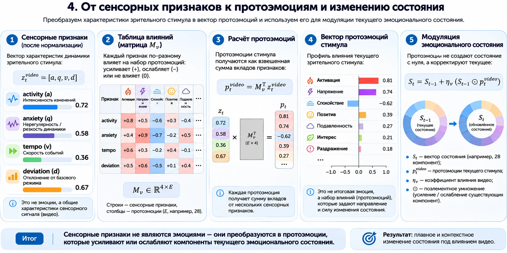
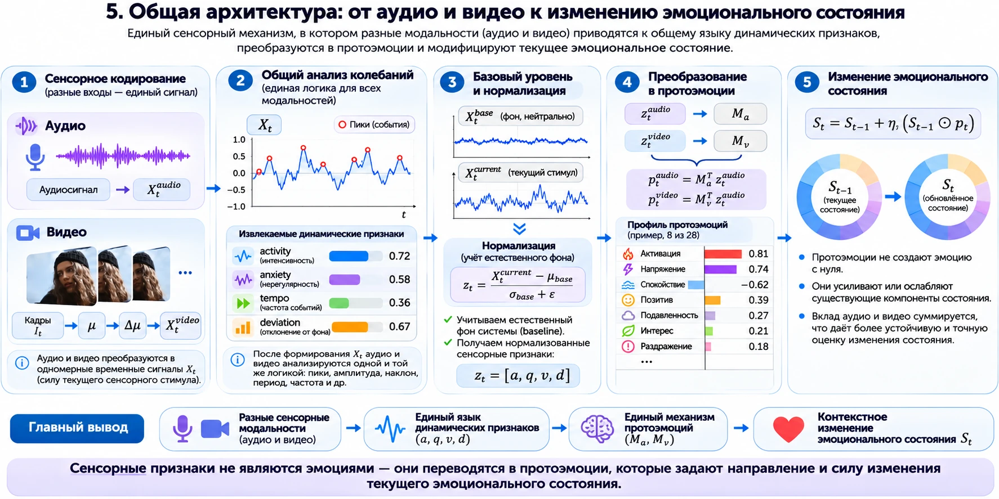

# Интеграция с эмоциональным состоянием агента

## Сенсорные признаки не являются эмоциями

`activity`, `anxiety`, `tempo` и `deviation` описывают динамику входного сигнала. Одинаковое резкое движение может сопровождать страх, радость, гнев или неэмоциональное событие. Смысл определяется контекстом и предыдущим состоянием агента.



## Опциональный адаптер

`VideoProtoEmotionMapper` реализует экспериментальную матрицу влияний для 28-компонентного состояния. Он принимает:

- нормализованные видеопризнаки;
- предыдущее состояние;
- коэффициент влияния видео `eta`.

И возвращает потенциалы и поправку. `deviation` задаёт силу воздействия, поэтому адаптер не создаёт эмоцию из нулевого состояния.

```python
import numpy as np

from sk_video_stimulus import (
    EMOTION_ORDER,
    NormalizedVideoFeatures,
    VideoProtoEmotionMapper,
)

features = NormalizedVideoFeatures(
    activity=0.3,
    anxiety=0.4,
    tempo=0.2,
    deviation=0.5,
)
previous_state = np.full(len(EMOTION_ORDER), 0.1, dtype=np.float32)

result = VideoProtoEmotionMapper().transform(
    features,
    previous_state,
    eta=0.2,
)
```

## Разделение подсистем



- `sk_video_stimulus` — динамика зрительного потока;
- `florence2-svoa` — семантика события в кадре;
- `sk_speech` — акустическая динамика и выразительность речи;
- `emotional-state-agents` — контекст, память и рекуррентное состояние.

Такое разделение не позволяет сенсорному всплеску автоматически превратиться в утверждение об эмоции пользователя.


