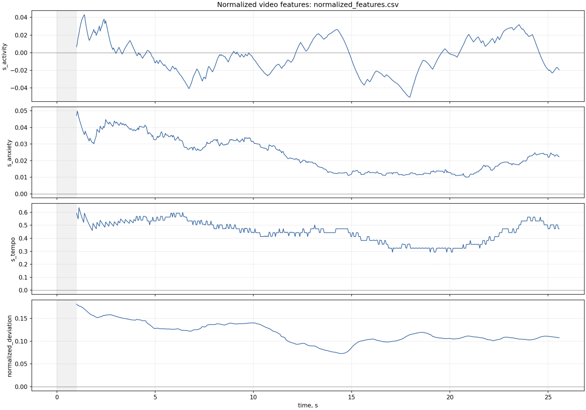
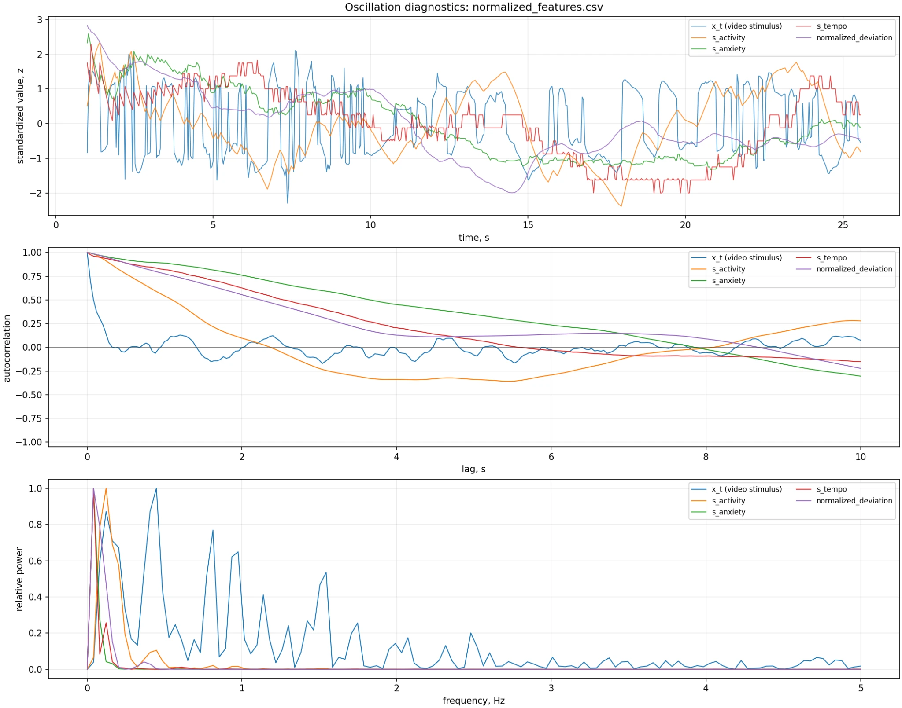
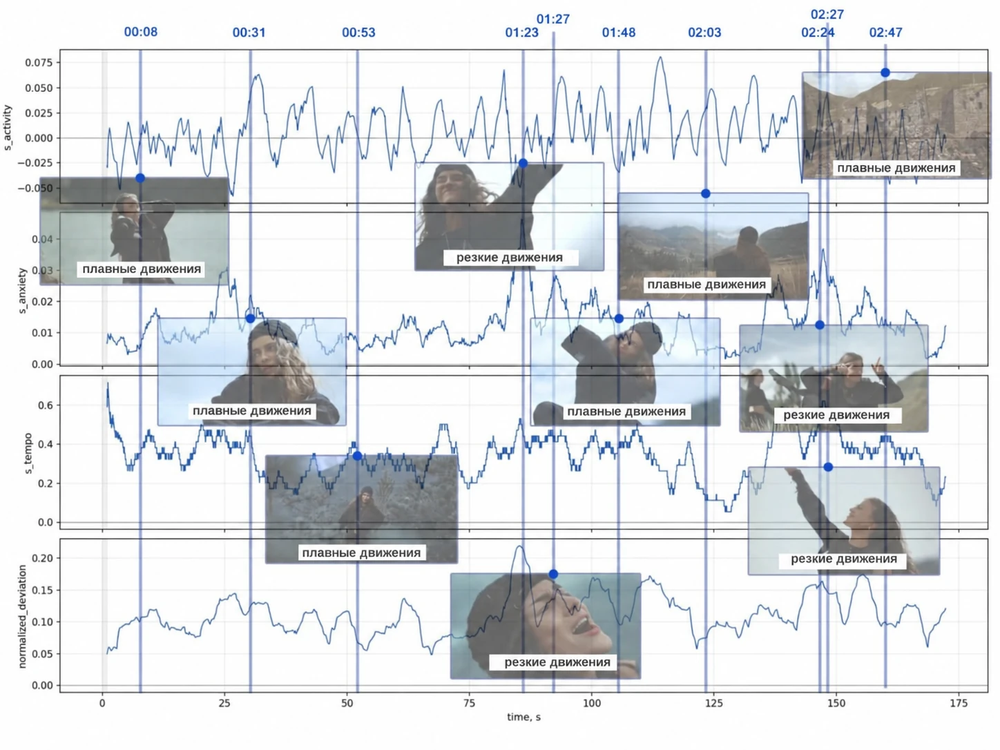

# Демонстрационные результаты

## Состав

Репозиторий содержит рассчитанные результаты трёх сценариев:

1. исходное видео — демонстрация сырых `x_t` и оконных признаков;
2. нейтральное видео — построение фиксированного фонового профиля;
3. отдельное тестовое видео — проверка нормализованных признаков.

Сами MP4 размещаются в [`examples/videos`](../examples/videos/README.md), а рассчитанные CSV уже находятся в [`examples/data`](../examples/data).

## Как читать графики

Высокое локальное значение не следует автоматически называть эмоцией. Оно показывает, что текущая динамика отличается от нейтрального режима по соответствующей характеристике.

Диагностический график содержит:

- стандартизированные временные ряды;
- автокорреляцию до 10 секунд;
- нормированный частотный спектр до 5 Гц.

Повторяемая форма должна давать вторичные пики автокорреляции и выраженную ненулевую частоту. Одиночный всплеск не является устойчивой осцилляцией.

## Сопоставление с кадрами

Подписи «плавные» и «резкие движения» являются ручной интерпретацией выбранных кадров, а не автоматическими классами пакета. Кадр около `00:08` показывает позу, которая в самом клипе почти не меняется; он иллюстрирует спокойный участок, а не активную позу. Максимумы соответствуют участкам, где поза или изображение действительно меняются.

## Ограничение примера

Приложенные результаты демонстрируют работоспособность пайплайна, но не являются статистической валидацией универсальных порогов. Для такой валидации потребуется набор видео с разными камерами, FPS, освещением и независимо размеченной динамикой.
