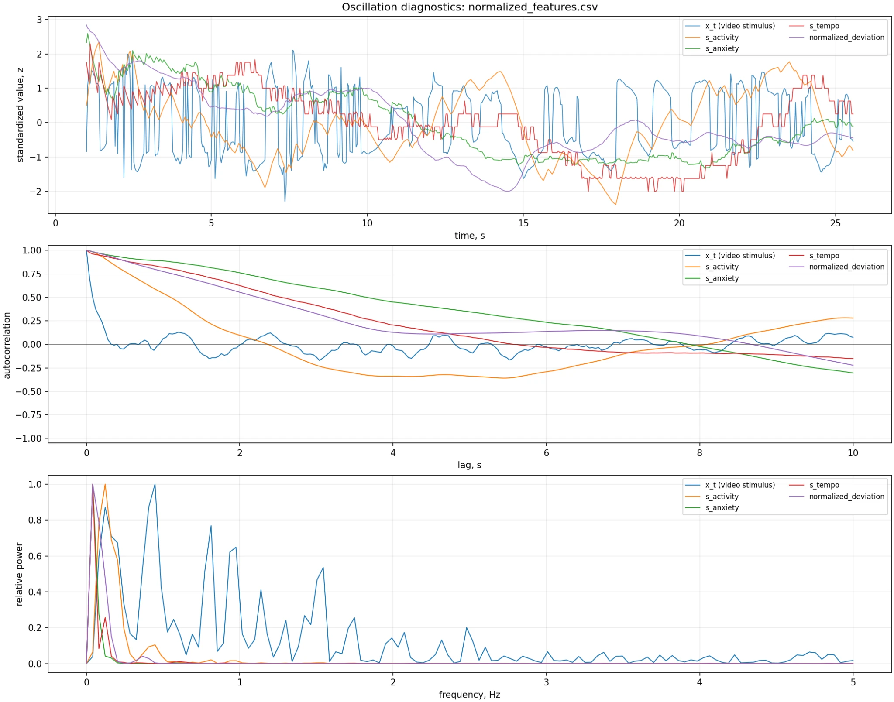

# Выходные признаки

## `x_t`

Быстрый подписанный сигнал сильнейшего пространственного изменения в текущем кадре. Он может резко меняться от кадра к кадру и является входом оконного анализатора.

## `activity`

Подписанное среднее окна с поправкой на наклон контура. Диапазон после внутреннего ограничения: `[-1, 1]`. Знак связан со знаком выбранных пространственных изменений и не означает положительную либо отрицательную эмоцию.

## `anxiety`

Ненормированный показатель нестабильности:

```text
deviation × (zero_crossing_rate + tempo × alternation + interval_cv)
```

Название сохранено из модели эмоционального состояния, но в самостоятельном пакете его следует понимать как **динамическую нерегулярность** — нерегулярность и резкость изменений. Это не оценка тревоги человека.

## `tempo`

Количество значимых положительных и отрицательных экстремумов на секунду. Для синусоиды 2 Гц обычно обнаруживаются около четырёх экстремумов в секунду, поскольку считаются и максимумы, и минимумы.

## `deviation`

RMS-мощность `x_t` в текущем окне. Для нормированного `x_t` ограничивается `[0, 1]`.

## Нормализованные столбцы

При использовании `--profile` CSV дополнительно содержит:

- `s_activity`;
- `s_anxiety`;
- `s_tempo`;
- `normalized_deviation`.

Первые три признака центрируются относительно нейтрального профиля и ограничиваются `[-1, 1]`. `normalized_deviation` является абсолютной величиной отклонения и остаётся неотрицательным.


